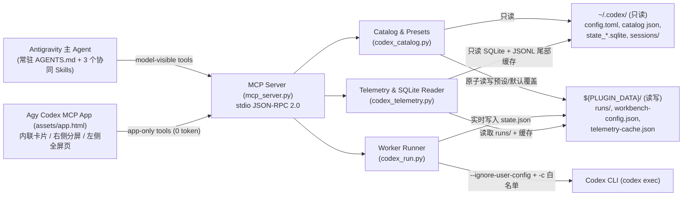

# Agy Codex (`agy-codex`) 完整架构与功能设计文档

- **项目名称**：`Agy Codex`（插件 ID / 仓库名：`agy-codex`）
- **仓库地址**：`https://github.com/Chino0w0/agy-codex`（Fork 自 `Silhouette-my/codex-in-anti`，MIT 协议）
- **日期**：2026-11-26
- **状态**：待用户审批（审批通过后再进入实施计划与编码阶段）

---

## 1. 背景与定位（Intent & Why）

`Agy Codex` 是面向 **Antigravity 2.0 + OpenAI Codex CLI** 深度协同的原生插件。它继承了上游 `codex-in-anti` 的白名单隔离（`--ignore-user-config`）与 MCP App 架构，并将其升级为**面向所有用户开箱即用**的跨模型子 Agent 调度与监控工作台：

1. **解决模型与配置隔离断层**：无论用户使用官方 OpenAI Codex、本地自定义 `model_catalog_json`（支持数十个自定义模型与扩展档位），还是多 Provider / LiteLLM 聚合网关，在默认 `isolated` 隔离模式下都能零冗余、零配置地精准命中目标模型、Provider 与全范围推理档位（`none` / `minimal` / `low` / `medium` / `high` / `xhigh` / `max` / `ultra` 及任意 catalog 声明档位）。
2. **打通 Antigravity ↔ Codex 子 Agent 编排**：提供模型发现、角色预设、单任务与并行 Worktree 派发、非阻塞状态查询、跨模型交叉审查（Second Opinion）与彻底进程树中止，配合常驻 `rules/AGENTS.md` 与 3 个高效率协同 Skill，让 Antigravity 成为稳定的总控编排者与审查者。
3. **类 Agy Powertools 的原生工作台体验（零客户端侵入）**：复用 Antigravity 官方 **MCP App** 的三大原生入口——**左侧边栏全屏页（`global`）**、**右侧分屏面板（`aux_pane`）**、**对话内联卡片（`inline`）**，提供实时子 Agent 监控台、融合本机 `~/.codex` 的全量 Token/缓存/耗时统计大盘，以及可视化模型与预设控制中心；**不走 CDP 页面注入**，与 `agy-powertools` 完全兼容且 Antigravity 客户端升级零破坏。
4. **产品级分发体验**：对标 `agy-powertools`，提供 `install.ps1` / `install.sh` / `install.py` 与对称 `uninstall` 脚本、一键复制给 Agent 执行的自动安装提示词、`docs/INSTALL_AGENT.md`、保留用户配置的覆盖升级，以及开箱环境体检 `doctor`。

---

## 2. 目标、非目标与反目标

### Goals（通用性 + 深度打通）
1. **双模模型与多 Provider 自适应（零硬编码）**：
   - 自动读取 `~/.codex/config.toml`、`~/.codex/worker.config.toml` 与 `${PLUGIN_DATA}/workbench-config.json`。
   - 存在 `model_catalog_json` 时自动解析（相对路径自动基于 `CODEX_HOME` 绝对化）并透传 `model_catalog_json`、`model_context_window`、`model_auto_compact_token_limit`、`model_reasoning_summary`、`service_tier`；**不存在 catalog 时自动降级为原生模式**，无缝支持官方默认模型与任意手输模型名。
   - 支持单次委派临时覆盖 `provider`（`model_provider`）、`model`、`effort` 或引用 `preset`（角色预设），同时透传目标 Provider 的标量字段与安全的一层嵌套字符串映射表（如 `http_headers` / `env_http_headers` / `query_params`）。
2. **完整的子 Agent MCP 工具集 + 规范化协同规则**：
   - Model-visible 工具：`list_codex_models`、`start_codex_task`、`wait_codex_task`、`get_codex_task_status`、`stop_codex_task`、`open_codex_panel`。
   - 常驻规则 `rules/AGENTS.md`（精简低开销，约 25-35 行）+ 3 个按需加载的协同 Skill（`codex-dispatch`、`codex-parallel-worktree`、`codex-second-opinion`）。
3. **三视图原生工作台（App-Only 轮询，0 主模型 Token 开销）**：
   - **子 Agent 监控**：统一展示活跃与历史任务（Antigravity MCP / 外部 CLI / 本机 Codex 会话）、Worktree 分支、实时折叠过程树、一键停止、文件直开侧栏、将结果/续聊指令发回主对话。
   - **用量统计看板**：支持切换数据范围（`全部 Codex` / `仅 Antigravity` / `仅本机 Codex`）与时间窗口（`今天` / `7天` / `30天` / `全部`），聚焦 Token 总量、输入/输出/推理拆分、缓存命中率、平均耗时、成功率、每日趋势图、按模型/Provider/档位分布与 Codex 内部父子线程树（`thread_spawn_edges`）。
   - **模型与配置中心**：可搜索模型目录（含 `display_name`、`slug`、`context_window`、支持档位徽章）、一键切换默认模型/Provider/档位、可视化编辑角色预设、内置 `doctor` 健康检查。
4. **跨平台开箱即用**：Windows / macOS / Linux 全支持，纯 Python 3.10+ 标准库（3.11+ 启用 `tomllib` 白名单隔离），预打包单文件 `assets/app.html`（终端用户零 Node.js 依赖）。

### Non-Goals（明确不做）
- **不做费用 / 价格估算**：聚焦真实研发效率指标（Token、缓存命中率、上下文占比、耗时、成功率、模型分布），不抓定价页、不维护价格表。
- **不做 Electron CDP DOM 注入**：不改 Antigravity 快捷方式，不往原生聊天输入框旁插悬浮控件，避免与 `agy-powertools` 冲突或在客户端更新时失效。
- **不修改 Codex 原生配置文件或数据库**：严格只读 `~/.codex/config.toml`、`~/.codex/auth.json`、`~/.codex/state_*.sqlite` 和 `~/.codex/sessions/**/*.jsonl`；本插件只写 `${PLUGIN_DATA}/` 下的运行数据/配置与 `~/.codex/worker.config.toml`（且首次安装已存在时默认跳过）。
- **不替换 Antigravity 原生 `invoke_subagent`**：作为互补的外部多模型 Codex 子 Agent 编排器，与 `superpowers` 等现有插件和平共处。

### Anti-Goals（红线）
- **绝不泄露任何敏感凭据**：`experimental_bearer_token`、`api_key`、`auth.json`、敏感 Header 值等绝不可出现在 MCP 返回值、UI 面板、`state.json`、`meta.json`、`doctor` 报告或日志文件中。
- **绝不因本机缺少可选文件而报错**：无 `model_catalog_json`、无 `state_*.sqlite`、无 `sessions/`、或 Codex 正写入 SQLite 锁库时，必须平滑降级，不影响核心任务派发。
- **绝不让 UI 刷新消耗主模型 Token**：所有面板轮询、统计查询、配置读取/保存、取消操作工具均严格标记 `visibility: ["app"]`。
- **绝不遗留孤儿进程**：取消或超时任务时，Windows 下必须清理整棵进程树（`taskkill /PID <pid> /T /F`），POSIX 下清理整个进程组（`os.killpg`）。

---

## 3. 备选方案对比（Approaches）

| 方案 | 架构路径 | 核心取舍 | 结论 |
| :--- | :--- | :--- | :---: |
| **方案 1：官方 MCP App 三视图工作台 + 融合本机 `~/.codex` 只读统计** | 利用 Antigravity 原生 `global` 侧栏页 + `aux_pane` 右侧分屏 + `inline` 内联卡片，纯 Python 标准库 MCP Server 聚合插件任务与本机 `~/.codex` SQLite/JSONL | 零客户端侵入、升级永不失效、与 `agy-powertools` 零冲突；同时兼容官方/自定义 catalog/多 Provider 用户 | **已选定** |
| 方案 2：官方 MCP App 轻量版（仅插件数据） | 不读取 `~/.codex` 历史 SQLite/JSONL | 实现略薄，但缺少本机 Codex 全量会话与用量视角 | 未采用 |
| 方案 3：Sidecar + Electron CDP 注入原生 UI | 仿 `agy-powertools` 注入 Electron 窗口 | 易与 `agy-powertools` 冲突且随 Antigravity 小版本更新频繁失效 | 明确排除 |

---

## 4. 总体架构与数据流



---

## 5. 核心模块设计

### 5.1 配置优先级、模型目录与白名单隔离（`codex_catalog.py` + `codex_run.py`）

#### 5.1.1 参数解析优先级（从低到高）
1. `~/.codex/config.toml`（用户桌面/CLI 基线配置，只读）
2. `~/.codex/worker.config.toml`（可选文本模板配置，只读）
3. `${PLUGIN_DATA}/workbench-config.json` 中的 `defaults`（面板保存的默认模型/Provider/档位/隔离模式）
4. 本次调用指定的 `preset`（角色预设中的非空字段）
5. 本次调用显式传入的参数（`model`、`provider`、`effort`、`mode`、`config_mode`）

> 关键说明：`worker.config.toml` 默认模板中**不再硬覆盖 `model_reasoning_effort = "medium"` 导致屏蔽用户原有习惯**——未在 `workbench-config.json` / `preset` / 单次参数指定 `effort` 时，遵循 `config.toml` 的 `model_reasoning_effort`（若均未配置再回退 `"medium"`）。

#### 5.1.2 `isolated` 白名单完整字段
- **标量字段**：`model`、`model_provider`、`model_reasoning_effort`、`model_reasoning_summary`、`model_context_window`、`model_auto_compact_token_limit`、`model_catalog_json`、`service_tier`、`personality`、`tool_output_token_limit`、`developer_instructions`。
- **相对路径 `model_catalog_json` 自动绝对化**：如果 `model_catalog_json` 为相对路径（如 `"models-catelog.local.json"`），在注入 `-c model_catalog_json="..."` 前必须解析为 `(codex_home / raw_value).resolve()`，避免 `codex exec -C <repo>` 切换目录后相对路径失效。若解析后的文件不存在，则发出非致命告警并跳过注入该键，防止阻断执行。
- **Provider 表透传**：根据最终生效的 `model_provider` 合并 `config.toml` 与 `worker.config.toml` 中的 `model_providers.<provider>`：
  - 透传全部标量字段（`name`、`base_url`、`wire_api`、`requires_openai_auth`、`env_key`、`supports_websockets`、`experimental_bearer_token` 等）；
  - 透传安全的一层嵌套字符串映射表（`http_headers`、`env_http_headers`、`query_params`），序列化为 `-c model_providers.<p>.<table_key>.<entry_key>="..."`。
- **安全脱敏**：`sanitize_command_for_meta()`、`doctor`、`list_codex_models`、`get_workbench_config` 对所有匹配凭据规则的字段统一脱敏为 `<redacted>`（白名单豁免非敏感数值/布尔字段如 `tool_output_token_limit`、`requires_openai_auth`）。
- **推理档位校验**：支持标准集合 `none / minimal / low / medium / high / xhigh / max / ultra` 及任意合法自定义标识符（`^[a-zA-Z0-9_-]+$`），彻底解除原版 `low|medium|high` 限制。

#### 5.1.3 双模模型发现（`discover_models_and_config`）
- 若存在有效的 `model_catalog_json`（兼容 `{"models": [...]}` 与顶层列表 `[...]`），提取每条模型的：`slug`（回退 `id`）、`display_name`、`default_reasoning_level`、`supported_reasoning_levels`（兼容对象数组与字符串数组）、`context_window`、`provider`。
- 若未配置 `model_catalog_json`，自动进入 `catalog_mode = "native"`：返回当前生效默认模型、全部已配置 Provider（脱敏后）、历史使用过的模型列表（可选来自近期运行记录）以及标准档位列表；允许传入任意 `model` 字符串。

#### 5.1.4 通用内置角色预设（`workbench-config.json`）
首次启动自动初始化以下 4 套开箱预设（均可在「模型与配置」面板修改或新增自定义预设）：
| Preset | 中文名 | 默认 `mode` | 默认 `effort` | 默认 `model` / `provider` | 适用场景 |
| :--- | :--- | :---: | :---: | :---: | :--- |
| `coding` | 编码实现 | `write` | `high` | 继承默认 | 模块实现、单元测试、功能开发 |
| `review` | 只读审查 | `read-only` | `medium` | 继承默认 | 跨模型 Code Review、风险与边界检查 |
| `debug` | 深度排查 | `read-only` | `xhigh` | 继承默认 | 复杂 Bug 根因定位、疑难架构诊断 |
| `fast` | 快速轻量 | `write` | `low` | 继承默认 | 样板脚本、文档整理、小型明确修改 |

---

### 5.2 常驻规则与高效率协同 Skills 体系（开箱即用的效率核心）

插件打包 **1 条极轻量常驻规则** + **3 个按需披露的高价值 Skill**，全部随插件自动发现（零手动配置）：

#### 5.2.1 常驻规则：`rules/AGENTS.md`（控制在 ~30 行，几乎不占上下文）
1. **统一路由**：只要用户要求将任务委派给 Codex / GPT / 指定 Codex 模型，或需要跨模型复核，优先使用 `agy-codex` MCP 工具（`list_codex_models` / `start_codex_task` / `wait_codex_task` / `get_codex_task_status` / `stop_codex_task`），不要直接在终端裸跑 `codex exec`。
2. **先发现再点名**：当用户给出模糊模型简称（如“用 6.2”、“用最快的模型”）或不确定支持哪些推理档位时，先调用 `list_codex_models` 解析精确 `slug`、`provider` 和支持的 `effort`，禁止瞎猜模型 ID。
3. **写权限与文件独占边界**：写任务运行期间，主 Agent 不得同时修改同一组文件；涉及 2 个以上独立写任务并发时，必须为每个任务启用 `worktree` 隔离。
4. **零盲信验收门禁**：任何写任务返回后，主 Agent 必须亲自核对 `git diff`（或变更文件）与关键验证命令结果，确认无误后再向用户汇报完成。
5. **面板引导**：当用户想看进度、历史任务、Token/缓存统计或修改默认模型预设时，调用 `open_codex_panel` 打开 **Agy Codex** 面板。

#### 5.2.2 三个内置协同 Skill（按需加载）
1. **`codex-dispatch`（核心单任务委派与模型路由）**：
   - 明确**何时派给 Codex vs 何时 Antigravity 亲自做**（避免把 2 行小改或需要浏览器/交互提问的任务派出去浪费冷启动）。
   - 提供**四段式自包含 Prompt 模板**（`Goal` 目标 / `Scope` 允许与禁止改动的精确路径 / `Context` 关键约束与报错片段 / `Verification` 必跑验证命令）。
   - 定义 **Preset & 档位选择指南** 与 **失败处理纪律**（检查 `log_file` 与 `error`，最多 `resume` 迭代 2 轮，仍卡住则换档位/换模型或主 Agent 接管，禁止死循环重试）。
2. **`codex-parallel-worktree`（多子 Agent 并行 Worktree 编排）**：
   - 教你如何将 2+ 个互不依赖的模块/测试域拆分为多个并行 `start_codex_task(worktree="<slug>", ...)`（可为不同子任务指定不同模型/预设）。
   - 利用 `get_codex_task_status` 非阻塞轮询进度，全部完成后逐一审查各 `codex/<slug>` 分支 diff、合并集成、跑全量回归并清理临时 worktree。
   - 明确与 `superpowers:dispatching-parallel-agents` 的协作边界（不冲突，互补）。
3. **`codex-second-opinion`（跨模型交叉审查与疑难会诊）**：
   - 在大改动合并前或卡在复杂 Bug 时，用 `preset="review"` 或 `preset="debug"`（锁定 `read-only` 沙箱）把另一模型家族请来独立挑刺或复核根因。
   - 输出按 `Critical / Important / Minor` 分级并附 `file:line` 证据，主 Agent 逐条技术甄别（不盲从、不敷衍）后再决定采纳或反驳。

---

### 5.3 本机 `~/.codex` 全量统计与子 Agent 融合引擎（`codex_telemetry.py`）

1. **双源融合与自动去重**：
   - **来源 A（Antigravity 插件任务，`mcp` / `cli`）**：合并内存态活跃任务 + `${PLUGIN_DATA}/runs/*/state.json`，含精确状态、模型、Provider、档位、预设、耗时、Worktree、`usage`（`input / cached / output / reasoning`）。
   - **来源 B（本机 Codex 历史，`codex_local`）**：自动查找 `~/.codex/state_*.sqlite`（取版本号最新的如 `state_5.sqlite`），严格只读模式连接（`mode=ro`，500ms timeout，`PRAGMA query_only = ON`），通过 `PRAGMA table_info` 动态探测列，读取 `threads` 与 `thread_spawn_edges`。
   - **去重**：当插件任务的 `session_id` 匹配 `threads.id` 时，在「全部 Codex」聚合视角下自动去重并归类为 Antigravity 来源，防止双算。
2. **JSONL 尾部精确用量缓存**：
   - 对近期本地会话（如最近 30 天或最近 200 条）存在 `rollout_path` 的文件，仅读取尾部块（例如最后 64 KiB，若未命中再适度扩大读取）解析最后一条 `event_msg:token_count` 与 `turn_context`，提取 `input_tokens / cached_input_tokens / output_tokens / reasoning_output_tokens / model_context_window`。
   - 按 `(path, mtime_ns, size)` 增量缓存于 `${PLUGIN_DATA}/telemetry-cache.json`，确保后续统计刷新在数十毫秒内完成；找不到 rollout 文件的旧会话自动回退到 SQLite 的 `tokens_used` 总量。
3. **跨平台路径清洗与降级**：
   - 自动清洗 Windows SQLite 中的 `\\?\` 扩展路径前缀（如 `\\?\E:\...` → `E:\...`）。
   - 若无 SQLite 文件、锁库超时或表结构剧变，捕获异常并返回 `warnings: [...]` 提示，统计面板优雅降级为仅展示 Antigravity 插件任务。
4. **统计指标（无费用估算）**：
   - KPI：`total_runs`、`running_count`、`success_rate`、`total_tokens`（拆分 `input / cached / output / reasoning`）、`cache_hit_rate`（仅在有精确 `input_tokens > 0` 的样本上计算并标注覆盖率）、`avg_duration_sec`（基于有耗时的任务）。
   - 维度拆解：`daily`（每日活跃数与 Token 趋势）、`by_model`、`by_provider`、`by_effort`、`recent_errors`。

---

### 5.4 MCP 工具接口清单（`mcp_server.py`）

插件配置 `mcp_config.json` 中 Server 名设为 `codex`（Antigravity 命名空间即为 `agy-codex_codex`），UI 资源 URI 为 `ui://agy-codex/app.html`（MIME：`text/html;profile=mcp-app`）。

#### Model-Visible 工具（主 Agent 可见）
| 工具名 | UI 挂载 | 核心参数与返回 |
| :--- | :--- | :--- |
| `list_codex_models` | 无 | 可选 `query`、`provider`；返回生效默认值、可用 Provider（已脱敏）、模型目录（含支持档位与上下文窗口）、原生兜底说明及全部角色预设 |
| `start_codex_task` | `inline` | 必填 `prompt`, `cwd`；可选 `model`, `provider`, `effort`, `preset`, `mode` (`write\|read-only`), `config_mode` (`isolated\|profile\|inherit`), `worktree`, `persist`, `session_id`, `search`, `add_dir`, `raw`, `timeout`；立即返回 `run_id` 与生效配置并在对话挂载实时卡片 |
| `wait_codex_task` | 无 | 必填 `run_id`，可选 `timeout`；阻塞等待完成并返回结构化交付、变更文件、Token 用量、Worktree 与日志路径 |
| `get_codex_task_status` | 无 | 必填 `run_id`（或 `run_ids` 数组）；非阻塞返回当前状态、耗时、最新一步命令/文件变更摘要与实时 Token，方便并行监控 |
| `stop_codex_task` | 无 | 必填 `run_id`；主动终止运行中的任务及其子进程树 |
| `open_codex_panel` | `aux_pane` + `global`（标题 `Agy Codex`） | 可选 `tab` (`subagents\|stats\|models`), `run_id`；打开工作台面板（支持空参 `{}` 启动） |

#### App-Only 工具（`visibility: ["app"]`，零主模型 Token 消耗）
- `get_run_events(run_id, since_seq=0)`
- `list_runs(status="all", limit=40)`
- `list_local_sessions(query="", limit=50, include_subagents=true)`
- `get_local_session_detail(thread_id)`（只读返回元信息、上下文占用、父子子 Agent 树、最近摘要）
- `get_stats(scope="all", range="7d", model="", provider="")`
- `get_workbench_config()`（返回完整模型目录、Provider、默认值、预设、`doctor` 体检结果）
- `save_workbench_config(defaults=..., presets=...)`（校验后原子写入 `${PLUGIN_DATA}/workbench-config.json`）
- `run_doctor()`（按需重新跑一次本机环境自检供面板展示）
- `cancel_run(run_id)`（终止 MCP 或外部 CLI 任务及其子进程树）

---

### 5.5 前端工作台设计（`plugin/agy-codex/ui-src/` → `assets/app.html`）

采用纯 TypeScript + 原生 DOM/CSS + 内联 SVG，经 `esbuild` 打包为单个离线 HTML（预期 `< 120 KiB`，远低于 10 MiB 限制），全程使用宿主 `--color-*` 变量以完美跟随 Antigravity 浅色/深色主题。

1. **内联模式（`is-inline`）**：
   - 保持极简高密度：运行状态 + 耗时 + `model` / `provider` / `effort`（及 `preset`）标签 + 实时 Token & 缓存命中率 + 停止按钮 + 折叠指令 + Codex 风格过程树 + 交付摘要 + 点击直开文件芯片。
2. **工作台模式（`is-panel`，自适应 `global` 宽屏与 `aux_pane` 窄屏）**：
   - 顶栏：`[子 Agent 监控]` `[用量统计]` `[模型与配置]` 三标签 + 实时运行中计数绿/蓝点 + 手动刷新。
   - **Tab 1（子 Agent 监控）**：宽屏左右双栏 / 窄屏上下切换；筛选条（`全部` / `运行中` / `Antigravity` / `本机 Codex`）；支持查看插件任务的实时折叠过程树、Worktree 分支与一键复制清理命令、停止按钮、文件直开侧栏；当 `app.getHostCapabilities()` 支持 `message` / `updateModelContext` 时，展示「发回当前对话复核 / 续聊」按钮（`global` 全屏页自动隐藏该按钮，严格遵循 MCP App 规范）；选中本机 Codex 会话时展示其元信息、上下文占比条与父子子 Agent 派生树。
   - **Tab 2（用量统计）**：范围切换（`全部 Codex` / `仅 Antigravity` / `仅本机 Codex`）+ 时间窗口（`今天` / `7天` / `30天` / `全部`）；4 张 KPI 卡（任务与会话数/成功率、总 Token 与输入/输出/推理拆解、缓存命中率、平均耗时）；纯内联 SVG 每日趋势柱状图；按模型排行表（占比条 + Token + 缓存命中率 + 错误数）；Provider 与推理档位分布标签；最近报错列表（一键复制）。
   - **Tab 3（模型与配置）**：顶部显示当前生效配置与 `doctor` 体检摘要（绿/黄/红状态 + 修复指引）；默认 Worker 配置表单（Provider 下拉、模型可搜索选择或手输任意原生模型名、推理档位动态联动当前模型支持列表、隔离模式选择）；4 套角色预设可视化编辑与自定义新增；可搜索的模型目录全表（展示 `display_name`、`slug`、`context_window`、支持档位，点击「设为默认」一键切换）。

### 5.6 精确数据契约与边界规则（技术拍板）

为消除实施歧义，以下边界行为明确固定如下：

1. **SQLite 与 Rollout JSONL 精确 Schema（兼容 `codex-cli 0.172.0` 及演进版本）**：
   - `threads` 时间戳：优先读取 `created_at_ms` / `updated_at_ms`（Unix 毫秒，除以 `1000.0`），缺失时回退 `created_at` / `updated_at`（Unix 秒；若数值 `> 1e12` 自动按毫秒折算）。
   - `threads` 分类字段：`thread_source` 取值含 `'user'`、`'subagent'`、`'guardian_review'` 等；`thread_spawn_edges` 列为 `(parent_thread_id, child_thread_id, status)`。
   - Rollout JSONL：`event_msg` 且 `payload.type == "token_count"` 包含 `payload.info.total_token_usage`（会话累计总量）、`payload.info.last_token_usage`（最近一轮用量）与 `payload.info.model_context_window`；`turn_context` 包含 `model`、`effort`、`cwd`。
   - `get_local_session_detail` 的摘要来源：组合 `threads` 元信息（`title`、`preview`、`first_user_message`、`git_branch`、`model`、`reasoning_effort`）+ `thread_spawn_edges` 子线程列表 + 从 Rollout JSONL 尾部提取的最近最多 5 条用户/助手纯文本片段（单条截断 400 字符，跳过大块工具输出）。
2. **双源 KPI 口径与去重规则**：
   - **严格分区去重**：在 `codex_local` 视图与 Tab 1「本机 Codex」筛选下，凡 `threads.id` 已匹配任意 Antigravity 插件 `run.session_id` 的记录均予以排除，确保 `all = antigravity ∪ codex_local` 严格互斥无双算。
   - **子线程计入 Token 与细分计数**：`subagent` / `guardian_review` 线程真实消耗 Token，计入 `total_tokens` 与各维度分布；`overview` 同时给出 `user_session_count` 与 `codex_subagent_count` 细分，Tab 1 默认支持折叠/展开内部子线程。
   - **Token 与上下文占比口径**：`total_tokens = input_tokens + output_tokens`（`cached_input_tokens` 为 `input_tokens` 子集，`reasoning_output_tokens` 为 `output_tokens` 子集，与上游 `mcp_server.py` 一致）；`cache_hit_rate = sum(cached) / sum(input)`（按有精确 `input_tokens > 0` 的样本加权并附带覆盖数）；单会话上下文占比条使用**最近一轮** `last_token_usage.input_tokens / model_context_window`，累计 KPI 使用 `total_token_usage`。
   - **成功率 / 平均耗时 / 最近报错口径**：因 `codex_local` SQLite 无明确退出码和活跃执行耗时，这三项指标仅统计 Antigravity 插件任务（`mcp`/`cli`），并在界面标注统计样本数，绝不将跨天挂起的本地会话时间混入平均耗时。
3. **模型覆写时的推理档位与上下文窗口处理**：
   - **档位自动平滑降级（不硬拒）**：定义标准档位序 `["none", "minimal", "low", "medium", "high", "xhigh", "max", "ultra"]`。当目标模型存在于 `model_catalog_json` 且声明了非空 `supported_reasoning_levels`、而解析后的 `effort` 不在支持列表内时（例如对仅支持到 `high` 的模型使用 `debug=xhigh` 预设），自动向最近的较低支持档位收敛（若目标档位低于最低支持档则取最低支持档；未在序列表内则回退 `default_reasoning_level`），并在 `start_codex_task` 返回体与 UI 中带出非致命 `warnings`（如 `effort clamped: xhigh -> high`）。目标模型不在 catalog 中时原样透传。
   - **上下文窗口防串味**：仅当本次任务使用的 `model` 与 `config.toml` 默认模型一致时，才透传 `config.toml` 的 `model_context_window` 与 `model_auto_compact_token_limit`；一旦单次任务覆写了不同 `model`，自动省略这两项让 Codex 直接读取目标模型在 catalog 或内置定义中的真实窗口上限。
4. **`model_catalog_json` 可见性与 Provider 归属**：
   - 支持读取 catalog 条目的 `visibility` 字段（如 `"list"` / `"hide"`）：`list_codex_models` 与 Tab 3 默认优先展示可见模型（`visibility != "hide"`），同时提供 `include_hidden=true` 参数与前端「显示隐藏模型」开关查看全量；执行校验与查找始终覆盖全部条目（含隐藏条目）。
   - catalog 条目未声明 `provider` 时视为适用于所有 Provider；若条目显式声明了 `provider` 且调用方未显式传 `provider`，则自动切换到该条目的 `provider`（显式传参始终最高优先级）。
   - 仅当 `config.toml` 未定义任何 `[model_providers.*]` 或当前 `model_provider == "openai"` 时，在 Provider 列表中自动补充内置 `"openai"` 选项。
5. **面板发回对话的交互语义与临时会话（`persist=false`）**：
   - `state.json` 必须持久化 `persist: bool` 字段。
   - Tab 1 在宿主具备对应能力时提供两个语义清晰分离的按钮（无能力时隐藏）：
     - **「发给主 Agent 复核」**（需 `capabilities.message`）：调用 `app.sendMessage()`，立即发送含 `run_id`、`model`、`changed_files`、`worktree.branch` 与摘要的简短复核请求，触发主 Agent 检查 diff。
     - **「附为下条消息上下文」**（需 `capabilities.updateModelContext`）：仅被动挂载上下文到用户下一条输入（不立即消耗模型轮次）；若 `persist=true` 且有 `session_id`，附带 `session_id` 方便用户续聊；若为临时会话（`persist=false`）或 `codex_local` 会话，则附带交付摘要与变更文件列表供用户另起后续任务，不构造无效的 `resume` 指令。

---

## 6. 插件安装、升级与卸载体验（对标 Agy Powertools）

- **单插件目录结构**（安装至 `~/.gemini/config/plugins/agy-codex/`）：
  ```text
  ~/.gemini/config/plugins/agy-codex/
  ├── plugin.json                # name: "agy-codex", displayName: "Agy Codex"
  ├── mcp_config.json            # command 在 Windows 自动写为 python，macOS/Linux 为 python3
  ├── assets/
  │   ├── app.html               # 预打包单文件 MCP App 前端
  │   └── logo.svg
  ├── rules/
  │   └── AGENTS.md              # 常驻路由与子 Agent 协作底线规则
  ├── skills/
  │   ├── codex-dispatch/SKILL.md
  │   ├── codex-parallel-worktree/SKILL.md
  │   └── codex-second-opinion/SKILL.md
  └── server/
      ├── mcp_server.py
      ├── codex_run.py
      ├── codex_catalog.py
      ├── codex_telemetry.py
      └── handoff_schema.json
  ```
- **统一安装与卸载入口**：
  - Windows：`powershell -NoProfile -ExecutionPolicy Bypass -File .\install.ps1` / `uninstall.ps1`（自动检测本机 Python 3.10+）
  - macOS / Linux：`sh ./install.sh` / `uninstall.sh`（统一委托 `install.py` / `uninstall.py`）
  - 可选安装独立 CLI Skill（`--with-cli-skill`，默认仅安装一体化插件避免重复技能名冲突，同时仍保留 `server/codex_run.py` 可命令行直接运行 `doctor` / `models` / `exec`！这是一个更干净的改进，避免 `codex-worker` 和插件内 skills 重复干扰）
  - 覆盖升级默认保留 `${PLUGIN_DATA}/workbench-config.json` 与 `runs/` 历史记录；卸载脚本提供 `--keep-data` 选项，且绝不触碰 `~/.codex/config.toml` 与其他 Antigravity 插件，也不修改 `~/.gemini/config/config.json`（Antigravity 自动发现插件目录）。
- **Agent 一键安装指南**：提供 `docs/INSTALL_AGENT.md` 与 README 中的复制即用提示词。

---

## 7. 关键工程拍板与留给实施阶段的细节

### 已拍板约定
1. **单源共享 + 一体化插件打包**：Python 核心模块统一在 `plugin/agy-codex/server/`（或 `core/` 复制到 `plugin/agy-codex/server/`）维护单份真源，取消双份技能并存带来的描述重复问题；CLI 调用与 MCP Server 共用同一套 `codex_run.py` / `codex_catalog.py` / `codex_telemetry.py`。
2. **命名空间与向后兼容**：新插件 ID 为 `agy-codex`；若用户同时安装了旧版 `codex-in-anti`，`install.py` 会温和提示旧插件路径，不擅自删除用户其他插件。
3. **无外部依赖**：Python 端坚持 100% 标准库；前端 `assets/app.html` 随仓库提交，零运行时构建依赖。
4. **Windows 进程树与路径处理**：`subprocess.Popen` 启动的 `codex` 在取消/超时时通过 `taskkill /PID <pid> /T /F` 彻底清理；Windows 下统一支持 `codex.cmd` / `codex.exe` / `codex.ps1`（优先 `.cmd`/`.exe` 避免 `Popen` 直接执行 `.ps1` 失败！）。
5. **CLI 命令分类器适配 Windows**：前端 `classifyCommand()` 除 `bash/zsh` 外，同步识别 PowerShell/CMD 包装命令（如 `powershell -Command ...` / `pwsh -c ...` / `cmd /c ...`），避免 Windows 下满屏原始外壳前缀。

### 留给实施阶段的细节
- `ui-src/` 下 TypeScript 模块拆分方式（如按 `types.ts`、`api.ts`、`views/inline.ts`、`views/subagents.ts`、`views/stats.ts`、`views/models.ts` 拆分，经 `esbuild` 打包为单文件 `assets/app.html`）。
- 新 Logo SVG 的具体视觉细节（简洁高对比度图标，适配深浅双色主题）。
- `unittest` 测试夹具的组织结构。

---

## 8. 验收标准

1. **自动化测试全绿**：`python -m unittest discover -s tests -v` 覆盖配置/目录解析（有/无 `model_catalog_json`、相对路径绝对化、多 Provider、全档位、凭据脱敏）、SQLite/JSONL 统计与缓存（含锁库/缺库降级、`\\?\` 路径、去重）、MCP JSON-RPC 协议全部工具、以及 `install.py` / `uninstall.py` 临时目录端到端验证。
2. **前端打包通过**：`npm install && npm run build` 成功输出 `plugin/agy-codex/assets/app.html` 且无报错。
3. **本机实测闭环**：
   - 运行 `install.ps1` 安装到 `~/.gemini/config/plugins/agy-codex/`；
   - `doctor` 全绿，且能发现本机 41 个 catalog 模型（15 个默认展示 + 26 个隐藏可切换）与 3 个 Provider；
   - 通过只读实测确认 `isolated` 模式下指定模型 + 档位可成功调通并返回结构化交付；
   - 刷新 Antigravity MCP 后，左侧栏与右侧栏可正常打开 **Agy Codex** 工作台并展示实时监控、统计大盘与模型配置。
